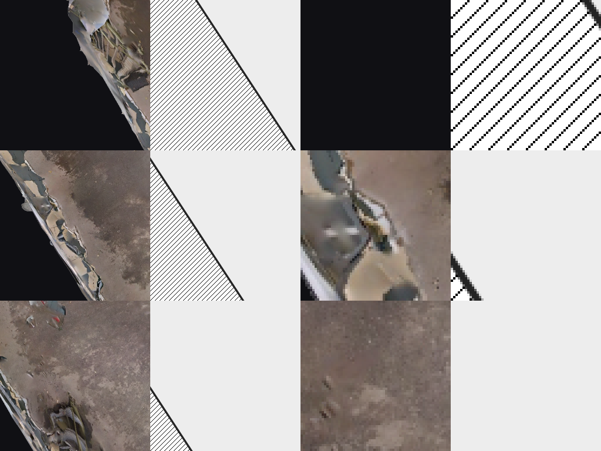

# mirea-airsoft-map

Полигон с геопривязанной ортофотопланой и 3D-моделью. Локальная сборка — то же, что потом поедет на GitHub Pages.

## Структура

| Путь | Что | В git |
|---|---|---|
| `index.html`, `app.js`, `plan.js`, `ui.css` | MVP просмотра: 3D/2D, сплит, model/Splat, свободная камера, карточка объекта без редактирования | да |
| `editor.js` | отложенный редактор; в MVP не загружается | да |
| `tiles/{z}/{x}/{y}.png` | XYZ-тайлы EPSG:3857, z15–z22, из `D:\04_AI\mirea\map\orto.tif` — **замер: 1377 файлов, 61.8 МБ, средний тайл 45.9 КБ** (671 содержательных + 706 прозрачных заглушек вместо 404) | да |
| `points.geojson` | 5 опорных точек, вычитаны из `mirea_mp.files\0\chunk.zip` | да |
| `shelters.geojson` | 71 укрытие из слоёв `tactical.gpkg` (buildings, objects, Бочки, vehicles) — один источник для плана и экструзии в 3D; `tools/make_geojson.py` | да |
| `zones.geojson` | `playzone` + `restricted` (контуры) и их же кольца-заборы `*-fence` высотой 2 м (`kind: zonewall`, толщина 1 м в плане) | да |
| `lines.geojson` | дорожки, тактические линии, щиты | да |
| `3dtiles/tileset.json` | 3D-модель из Metashape: **3D Tiles 1.1, контент `.glb` — 325 файлов, 53.9 МБ**, самый большой 0.81 МБ, в `Data/` 322 файла (лимит 3000 на каталог ✓). Metashape отдаёт `.3tz` (47.6 МБ) — это ZIP; CesiumJS читает только распакованный тайлсет, поэтому архив распакован, а сам `.3tz` лежит вне репозитория (`D:\04_AI\mirea\export\`) | да |
| `splats/tileset.json` | Gaussian splats (если будут): PLY → `gotiler` → 3D Tiles 1.1 с `KHR_gaussian_splatting`/SPZ, CesiumJS рисует сам. Пайплайн и геопривязка — [docs/SPLATS.md](docs/SPLATS.md) | да |
| `vendor/cesium/` | CesiumJS локально, без CDN | да |
| `tools/make_tiles.py` | нарезка тайлов | да |
| `.build/`, `.venv-tile/` | временное (warped-растр, npm) | нет |

## Локальный запуск

```powershell
# 1. тайлы (нужен один раз; ~1300 файлов)
.venv-tile\Scripts\python.exe tools\make_tiles.py --zmin 15 --zmax 22

# 2. статический сервер от корня данных (нужен ../map/tactical.gpkg)
python -m http.server 8765 --bind 127.0.0.1 --directory D:\04_AI\mirea
# открыть http://127.0.0.1:8765/mirea-airsoft-map/
```

CesiumJS ставится так: `npm install --prefix .build/npm cesium`, затем `Build/Cesium/*` копируется в `vendor/cesium/`
(замер: 345 файлов, 21.8 МБ, из них `Cesium.js` 5.95 МБ). Никаких обращений к Cesium ion нет:
`Ion.defaultAccessToken = undefined`, подложка своя, рельеф — эллипсоид.

### Текущий MVP (22.11.2026, ADR-26)

Приложение работает без сборки. Изменения в `index.html`, `app.js`, `plan.js` и `ui.css` видны после перезагрузки страницы.

- 3D-модель загружается при старте. Splat загружается по кнопке и заменяет модель; одновременно они не отображаются. Повторный клик по активному ресурсу возвращает ортофотоплан.
- При активной модели или Splat глобус с орто в 3D скрыт, поэтому текстуры и поверхности не конкурируют за глубину. Орто остаётся на 2D-плане и возвращается в 3D при выключенных ресурсах.
- По умолчанию 2D использует «Схема» (QGIS-тайлы). Кнопка «Карта» переключает на ортофотоплан.
- Сплит показывает 3D слева и 2D справа. Полный 2D использует тот же canvas-план на весь экран. На узком экране панели сплита располагаются друг под другом.
- Координаты центра плана и масштаб отображаются только над 2D. Линейка выбирает круглое значение и ограничена 160 px.
- Векторные слои и карточка объектов отключены. Панель слоёв и редактор в MVP отсутствуют; `editor.js` сохранён для отдельного рефактора. Внешний GPKG и sql.js не загружаются, сайт работает автономно на GitHub Pages.
- Без WebGL приложение открывает полный 2D и показывает причину недоступности 3D.

Управление в 3D:

| Ввод | Действие |
|---|---|
| W / A / S / D | движение по направлению взгляда и вбок |
| Q / E | вниз / вверх по вертикали |
| Shift | ускорение |
| ПКМ с перетаскиванием | свободный обзор |
| Колесо | приближение / отдаление вдоль взгляда |
| R | исходный ракурс |

На 2D перетаскивание двигает карту, колесо меняет масштаб. На телефоне одиночный палец двигает карту, щипок приближает и отдаляет. С клавиатуры используются стрелки, `+`/`-` и `Home` для возврата ко всему полигону.

Проверки перед релизом:

```powershell
node --check app.js
node --check plan.js
node tests/mvp_release_test.mjs
node tests/gpkg_codec_test.mjs
python -X utf8 ..\ai-project\verify\gpkg_check.py ..\map\tactical.gpkg
```


### Рамка высот (важно)

Орто лежит на эллипсоиде (в GeoTIFF высот нет), а Metashape-данные — на реальной высоте участка ≈188 м.
Без приведения 3D-модель и сплаты висели в 188 м над подложкой: сверху вниз незаметно, с наклона видно.
Теперь каждый тайлсет сдвигается на −188 м (`GROUND_H` + `flattenTileset()` в `app.js`); когда
появится DEM/рельеф, сдвиг убираем. Проверено численно: `sampleHeight` модели в 5 GCP = реальная высота − 188
(0.0 / 0.0 / 0.0 / 0.0 / +3.0 — gcp-6 на крыше). То есть **высоты в кадре приложения = реальные − 188**.

### Экспорт тайлов из QGIS — не подошёл

`Generate XYZ tiles (Directory)` выдал 1233 файла / 4.3 МБ, но тайлы **пустые**: покрытие 100 %
(альфа потеряна), резкость 3.5 против 17.9–21.7 у нашей нарезки, на скриншоте — белая подложка с
одной линией. Причина — экспортировался не растровый слой орто (активным был векторный слой либо
орто было снято с отрисовки). Рабочая пирамида — `tiles/` из `tools/make_tiles.py`.



`python -m http.server` не отдаёт Range-запросы (на `tiles/` это не влияет, COG не используется). GitHub Pages
Range отдаёт — проверено ранее (`206`, `Accept-Ranges: bytes`).

## Геопривязка (проверено по файлам)

- `orto.tif`: EPSG:4326, экстент 37.4795878 / 55.6722190 — 37.4821302 / 55.6737276, 11 849 × 12 442 px,
  RGBA, GSD 1.35 см/px, заполненность 8.84 % → тайлы ограничены прямоугольником экстента.
- Metashape: `<reference>` = EPSG:4326, `chunk.transform.scale` = 11.8893,
  `translation` = (2 860 831.6, 2 193 683.2, 5 244 148.3) → метры WGS84 ECEF. Экспорт модели делать в CRS
  WGS84 / ECEF (`EPSG::4978` для тайлсета).

## Лимиты, под которые подгоняется репозиторий

git: файл ≤ 100 МБ (1 МБ — комфорт), 3000 записей в одном каталоге; Pages: сайт ≤ 1 ГБ, трафик мягко 100 ГБ/мес.

Замер репозитория целиком (без `.venv-tile/`, `.build/`, `.git/`): **2068 файлов, 139.4 МБ** —
`tiles/` 61.8 МБ + `3dtiles/` 53.9 МБ + `vendor/cesium/` 21.8 МБ + вектор и код. Самый большой файл —
`vendor/cesium/Cesium.js` 5.8 МБ. Все лимиты соблюдены с запасом; дробить `3dtiles/Data/` не нужно
(322 файла в каталоге).
