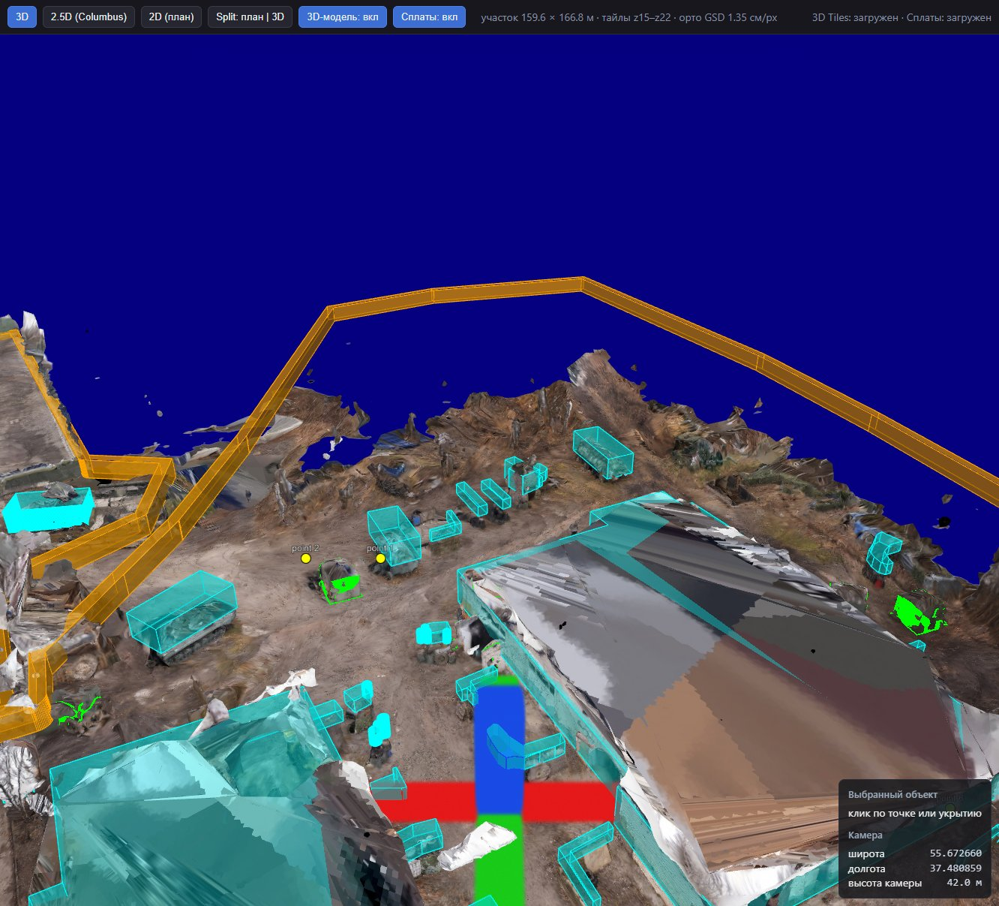

# Сплаты (3D Gaussian Splatting) с геопривязкой

## Что уже работает — проверено на этой машине

- **CesiumJS 1.147** (наш `vendor/cesium/`) рисует сплаты **сам**, без плагинов и CDN: в сборке есть
  `GaussianSplat3DTileContent`, `GaussianSplatPrimitive`, `GaussianSplatSorter`,
  `GaussianSplatTextureGenerator`, pass `GAUSSIAN_SPLATS`, а в списке glTF-расширений —
  `KHR_gaussian_splatting` и `KHR_gaussian_splatting_compression_spz_2` (SPZ-декодер — WASM внутри сборки).
- Конвертер **gotiler v3.2.0**: `D:\04_AI\mirea\tools\gotiler\gotiler.exe` (47 МБ, sha256 сверен с релизом,
  GNU AGPLv3, внутри своя PROJ-база дат). Он делает из PLY именно то, что читает наш Cesium:
  **3D Tiles 1.1 с SPZ-сжатыми glTF-сплатами**.
- Цепочка прогнана целиком на синтетике: `tools/make_test_splats.py` (5427 сплатов: крест 20×2 м + башня 8 м)
  → `gotiler splats` → **3 тайла за 66 мс** → CesiumJS отрисовал сцену ровно в точке полигона.



## Как положить сплаты в проект

Основной путь — экспорт **3D Tiles** из LichtFeld Studio с плагином Geo Register (см. ниже): получаешь
`tileset.json` + `tiles/`, кладёшь в `splats/`, просмотрщик подхватывает сам, кнопка «Сплаты: вкл/выкл».

Запасной путь — `gotiler` из PLY (флаги ниже). Пробный тайлсет вне репозитория открывается ссылкой:
`http://127.0.0.1:8765/?splats=./.build/splats_test/tileset.json`.

```powershell
D:\04_AI\mirea\tools\gotiler\gotiler.exe splats `
  -o splats --input-up-axis -y --scale 1 `
  --longitude 37.480859 --latitude 55.672973 --height 188 --heading 0 `
  --min-opacity 0.05 --max-sh-degree 0 --no-preview scene.ply
```

| флаг | зачем |
|---|---|
| `--input-up-axis` | ось «вверх» в исходной сцене: у сцен, обученных по COLMAP/OpenCV, обычно `-y` |
| `--scale` | приводит произвольные единицы обучения к метрам |
| `--longitude --latitude --height` | куда ставить **низ-центр** сцены (высота над эллипсоидом) |
| `--heading --pitch --roll` | поворот от локального севера; heading = азимут(орто) − азимут(сплаты) |
| `--max-sh-degree` | 0 — цвета не зависят от ракурса (сильно легче), 3 — как на входе |
| `--min-opacity` | 0.05 выбрасывает почти невидимые сплаты (мусор обучения) |
| `--splats-per-tile` | 40000 по умолчанию; крупнее — меньше файлов, тяжелее первый кадр |
| `--no-preview` | его предпросмотр требует интернет и Cesium ion — нам не нужен |

Просмотрщик подхватывает `splats/tileset.json` сам, кнопка **«Сплаты: вкл/выкл»**. Пробный тайлсет вне
репозитория открывается ссылкой: `http://127.0.0.1:8765/?splats=./.build/splats_test/tileset.json`.

## Где брать сплаты: LichtFeld Studio + плагин Geo Register

Metashape 3DGS не обучает. Рабочий путь под твой стек (ты в LichtFeld Studio):

1. **Учить сцену в LichtFeld Studio** по тем же фотографиям (Nvidia GPU + SSD; 4090 хватает).
2. **Плагин [dozeri83/geo-register-plugin](https://github.com/dozeri83/geo-register-plugin)** в LichtFeld
   Studio решает similarity-преобразование `world_ecef = scale · R · p_scene + t` (RANSAC + IRLS) и
   выгружает сцену как **3D Tiles 1.1 с `KHR_gaussian_splatting` + SPZ v3** — то, что наш CesiumJS 1.147
   читает нативно (авторы проверяли на CesiumJS ≥ 1.139).
3. Источник геопривязки в плагине — **Metashape Cameras XML** (чанк обязан быть в EPSG:4326, у нас так) или
   **Image Positions CSV**. CSV генерю из уже привязанного по GCP чанка: `tools/metashape_cameras_csv.py`
   (Scripts → Run Script в Metashape) → `D:/04_AI/mirea/export/lichtfeld_cameras.csv`.
   Так сплаты наследуют привязку 3D-модели по 5 GCP, а не «на глаз».
4. Плагин сам пишет `~/.lichtfeld/data/plugin_data/geo_register_pluggin/<project-key>/similarity_transform.json`
   (scale, R, t, RMSE, инлаеры) — по нему сверяем привязку числами.
5. Экспорт: **3D Tiles**, режим **LOD** (для полигона) или **Single tile** (отдельное укрытие),
   **Max SH 0** для веба. Перед экспортом вычистить мусор **Crop Box → Fit Trim → Apply**: летящие
   сплаты раздувают extent и зритель улетает далеко.
6. Результат кладём в `splats/` — просмотрщик подхватит сам.

Настройки LOD по умолчанию (Error scale 16, Levels Auto, Chunk splats 100K, Chunk extent 16 м) оставляем:
Auto важен — зритель грузит самый грубый уровень первым, и если уровней меньше, чем надо, тайлсет мигает.

**Запасной путь (без плагина):** `gotiler` — `D:\04_AI\mirea\tools\gotiler\gotiler.exe`, PLY → 3D Tiles 1.1.
Плюс: свой PROJ, очень быстрый. Минус: привязку задаём вручную флагами (низ-центр + heading + scale).

```powershell
D:\04_AI\mirea\tools\gotiler\gotiler.exe splats `
  -o splats --input-up-axis -y --scale 1 `
  --longitude 37.480859 --latitude 55.672973 --height 188 --heading 0 `
  --min-opacity 0.05 --max-sh-degree 0 --no-preview scene.ply
```

## Как привязать к земле (главная часть)

1. **Плагин Geo Register решает всё сам** по CSV/XML камер: scale + поворот + сдвиг в ECEF, и сам же
   прописывает это в `transform` корневого тайла. Проверка — RMSE в `similarity_transform.json` и
   `sampleHeight` в 5 GCP (ждём 0–3 м).
2. Если привязываем вручную (gotiler): `--input-up-axis -y`, если учил COLMAP/OpenCV.
3. `--scale`: делим известные метры на «единицы сцены» (расстояние между gcp-1 и gcp-2, ширина ангара).
4. `--longitude/--latitude`: координаты точки, которую узнаём в сцене (это **низ-центр**). Старт — центр
   полигона 37.480859 / 55.672973.
5. `--heading`: по двум опорным точкам — азимут вектора на орто минус азимут того же вектора в сплатах.
6. Проверка цифрами, как с 3D Tiles: `sampleHeight` тайлсета в 5 GCP против высот GCP (ждём 0–3 м).
6. Если нужен полный 6/7 DoF (сдвиг + поворот + масштаб) — делаю подгонку по GCP и перегенерирую placement.

## Рамка высот — исправлено 21.11.2026

Орто лежит **на эллипсоиде** (в GeoTIFF только широта/долгота, высот нет), а данные Metashape — на реальной
высоте участка ≈ 188 м. До правки 3D-модель и сплаты висели **в 188 м над подложкой**: сверху вниз это
незаметно, с наклона камеры видно сразу. Сейчас `index.html` сдвигает любой тайлсет на −188 м
(`GROUND_H`, `flattenTileset()`), поэтому Metashape-экспорт остаётся с настоящими ECEF-высотами, а gotiler
ставим с `--height 188` — всё сходится в одной плоскости. Когда появится реальный рельеф (DEM/terrain),
сдвиг убираем.

## Вес и лимиты

- тест: 5427 сплатов → 2 glb по 7 КБ;
- ориентир автора gotiler: 259 млн сплатов (PLY 16.3 ГБ) → 5 мин 50 с на i5-13600K / 32 ГБ / NVMe;
- для Pages держим весь сайт ≤ 1 ГБ: сейчас 139 МБ, сплаты добавляем с `--max-sh-degree 0` и
  `--min-opacity 0.05`;
- ограничения сплатов в CesiumJS: их нельзя кликать и экструдировать как полигоны, теней нет, поддержка
  помечена как экспериментальная — производительность на телефоне ещё проверяем.

## Почему привязка по EXIF ломается (замерено 21.11)

Geo Register решал по `mirea.xml` → `<reference>`: это GPS с телефона, и у целой серии кадров он
одинаковый (`IMG_..._TIMEBURST1..5` → 55.6736038, 37.4794164, 188.9). Итог плагина: инлаеров
296/1399, RMSE 4.375 м, scale 0.169555 — отсюда «перевёрнуты и не там на ~150 м».

При этом сами сцены совпадают идеально. Замер по 1993 камерам (COLMAP `sparse/0/images.bin` против
`mirea.xml <transform>`):

- попарные расстояния между одними и теми же камерами: COLMAP 49.1 м, Metashape 49.1 м,
  отношение 1.000 на 10–90 персентилях;
- форма облака центров (σ по главным осям): у обоих [38.5, 19.2, 0.7] м;
- similarity-фит COLMAP → метрическая рамка чанка Metashape: **scale = 1.00000000, RMSE = 0.0000 м**.

Вывод: LichtFeld/COLMAP-сцена = Metashape-модель в метрах (поворот + перевод). Цель для регистра
надо брать из позицией камер **после выравнивания и привязки по GCP**, а не из EXIF:
`tools/metashape_cameras_csv.py` → в плагине Source = Image Positions CSV. После этого RMSE фита
должна быть доли метра, а не 4.4 м. Проверочные скрипты: `.build/congruence.py`,
`.build/colmap_to_ecef.py` (эталон в `.build/colmap_to_ecef.json`).
